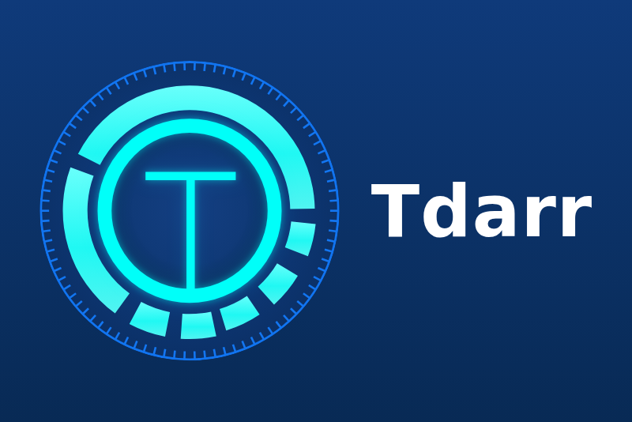

# Tdarr for Gladys Assistant

An external integration for [Gladys Assistant](https://gladysassistant.com) that
brings a [Tdarr](https://tdarr.io) server (distributed transcoding of a media
library) into Gladys, over the local network.



## What it does

- **The server**: transcode and health check queues, files in progress,
  transcoded files waiting for review, files transcoded and in error, space
  saved (GB), nodes online, version, and a switch that pauses every node.
- **Each node**: online, active workers, and a pause switch.
- **Each library**: files, files to process, files in error, space saved.
- **Scene triggers**: the queue is emptied (everything processed), a file
  failed (transcode or health check, with its name and library), a node went
  offline.
- **Scene actions**: pause Tdarr and resume Tdarr (one node or every node),
  scan a library for new files, read a summary sentence for a message or a
  voice announcement.
- **Dashboard widget**: queue, files in progress and in error, space saved,
  one row per node, and a button to pause or resume every node.
- The commands (pause, resume, scan) can be turned off in the configuration:
  the integration then only reads.

The user documentation, in English, French, German and Spanish, is in
[`docs/`](docs/en.md) and is shown by Gladys.

Tested against a real Tdarr 3.01 server (the official Docker image, with its
internal node), not yet in a real Gladys installation: feedback welcome on the
[Gladys forum](https://community.gladysassistant.com) or in the
[issues](https://github.com/guim31/gladys-tdarr/issues).

## Requirements

- Gladys Assistant 5.1.0 or later.
- A Tdarr server (version 2 or 3) reachable from Gladys, on the port of its web
  interface (`8265` by default).
- When the Tdarr authentication is on (Tdarr 2.24 or later, on by default in
  Tdarr 3): an API key (Tdarr: **Tools** → **API keys**).

## Installation

In Gladys: **Integrations** → **Install from GitHub**, with the address of this
repository: `https://github.com/guim31/gladys-tdarr`. Then enter the address of
the Tdarr server (and its API key) in the configuration, and add the devices
from the **Discover** tab.

## How it works

The integration reads the Tdarr API (`/api/v2`) at the chosen interval (1
minute by default): `/status`, `/get-nodes`, `/cruddb` (statistics, libraries,
global settings), `/stats/get-pies` (per library, every 15 minutes or when the
statistics change), `/client/staged`, and `/client/status-tables` when the
error counts grow. The pause switches use `/update-node` (one node) and the
`pauseAllNodes` global setting (every node), the scan uses `/scan-files`.
Only the changes are sent to Gladys. Nothing is changed in Tdarr besides the
pause and the scan, and nothing is deleted.

## Limits

- One Tdarr server per integration.
- A node is known by its name (Tdarr gives it a new id at each start):
  renaming a node creates a new device.
- **To process**, per library, is the "Queued" status of Tdarr, which also
  counts the files waiting for review.
- A short transcode can finish between two readings; at most ten failed files
  are announced per reading, and errors older than an hour are not announced.

## Development

```bash
npm ci
npm run format:check && npm run lint && npm test
npx -y github:GladysAssistant/integration-store --skip-image-check .
```

The tests run against the fake Gladys of the SDK and an in-memory Tdarr server
built from real answers of Tdarr 3.01 (`test/fixtures/tdarr/`, anonymized). See
[`CLAUDE.md`](CLAUDE.md) for the architecture and the pitfalls.

## Credits

- [Tdarr](https://tdarr.io) by HaveAGitGat. The logo of the cover comes from
  the official repository
  ([`assets/tdarr-logo.svg`](https://github.com/HaveAGitGat/Tdarr/tree/master/assets)).
- The API calls follow the ones of the Home Assistant custom integration
  [tdarr_ha](https://github.com/itchannel/tdarr_ha) by itchannel (no code
  copied), checked against a real Tdarr 3.01 server.
- Built on the official
  [integration template](https://github.com/GladysAssistant/integration-template-js)
  and SDK of Gladys Assistant.

Not affiliated with Tdarr or its authors. Licensed under the
[Apache License 2.0](LICENSE).
